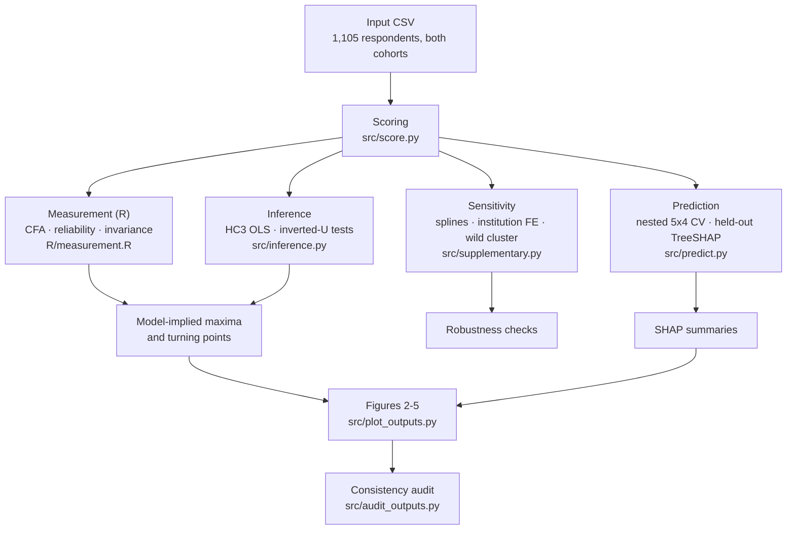
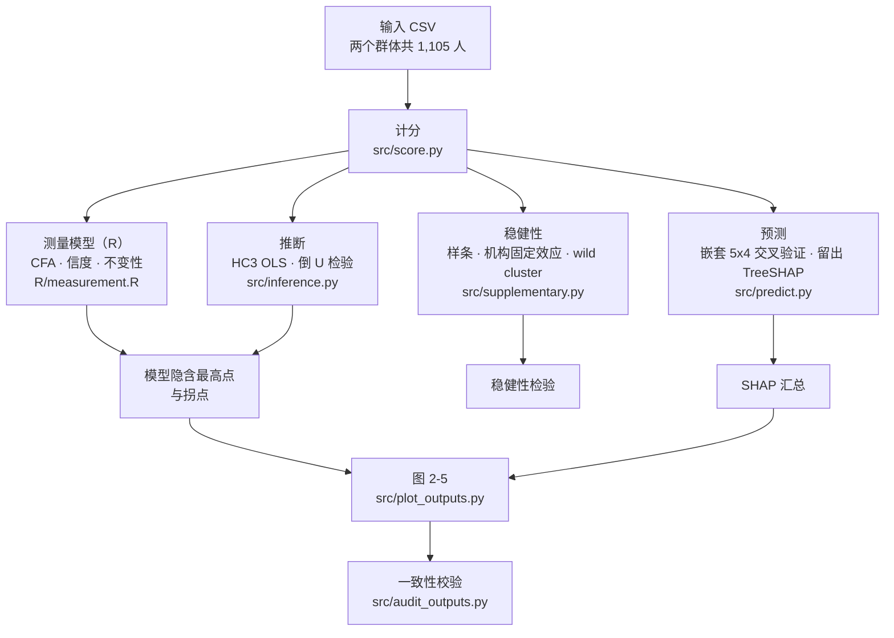

<div align="center">

# Calibrating Generative AI Use for Sustainable Higher Education

### Cross-sectional evidence on perceived capability and AI dependence

[](https://www.mdpi.com/journal/sustainability)
[](#)
[](#)
[](#at-a-glance)
[](#at-a-glance)
[](LICENSE)

**English** · [简体中文](#简体中文) · [Manuscript source](paper/sustainability-4495862.tex) · [Supplementary archive](supplementary/sustainability-4495862-supplementary.zip)

</div>

---

This repository accompanies the manuscript **“Calibrating Generative AI Use for Sustainable Higher Education: Cross-Sectional Evidence on Perceived Capability and Dependence”** (manuscript ID `sustainability-4495862`), accepted for publication in *Sustainability* (MDPI). It releases two things: the **accepted LaTeX manuscript source**, and the **complete analysis code package** that produced every table, appendix, and figure in the paper.

The study asks whether the frequency of generative-AI task use relates to perceived role-specific capability and to AI dependence in the same way. Using a cross-sectional survey of **1,105 respondents** (659 students and 446 teachers) from five Beijing universities, it finds a **concave (inverted-U) association** between use frequency and perceived capability — positive over the lower range of use, negative over the upper range — with the model-implied maximum located *inside* the observed range of use. AI literacy shifts where that maximum sits, while AI dependence follows a largely **additive** path driven by use, habit, and trust rather than by an inverted U.

> **Interpretation boundary.** The design is cross-sectional and the estimates describe **between-person** associations. They are not individual optimal use levels, not causal effects, and not evidence about performance retained after AI support is withdrawn. The sustainability constructs discussed in the paper are theorised institutional micro-foundations, not directly measured variables.

## At a glance

| Item | Description |
|---|---|
| Manuscript | `sustainability-4495862`, *Sustainability* (MDPI); received 27 Jul 2026, revised 22 Sep 2026, accepted 23 Sep 2026 |
| Authors | Xinchen Zhang, Yile Wang, Chunbing Li\* — School of Economics, Beijing Technology and Business University |
| Design | Cross-sectional, parallel-instrument survey (student and teacher versions) |
| Fieldwork | October–December 2025; five Beijing universities, anonymised as Institutions A–E |
| Analytical sample | 1,105 respondents — 659 students, 446 teachers (1,196 returned; 91 excluded by pre-specified quality screening) |
| Outcomes | Perceived learning agency (students, 7 items) and teaching innovation competence (teachers, 6 items); AI dependence (8 / 5 items) |
| Focal predictors | GenAI task use frequency (5 items, 7 ordered categories); AI literacy (12 items, four dimensions) |
| Mediators / controls | Trust (3), habit (3), perceived risk (3), plus demographics, discipline, AI tenure and overall use frequency |
| Core methods | CFA in `lavaan`; hierarchical OLS with HC3 errors; formal inverted-U tests; paired case bootstrap; nested out-of-fold prediction with held-out TreeSHAP |
| Robustness | Restricted cubic splines, RESET, Breusch–Pagan, institution fixed effects, leave-one-institution-out, HTMT bootstrap, ICCs, wild-cluster bootstrap |
| Ethics | BTBU Science Research Ethics Committee, protocol **2025-(70)**, approved 1 Sep 2025; informed consent obtained |
| Funding | None |
| Repository contents | Accepted manuscript source + full analysis code package (54 files) |

## Research questions

1. What functional form characterises the cross-sectional association between GenAI task use frequency and perceived role-specific capability?
2. Does AI literacy — globally and by dimension — shift the location of the model-implied capability maximum?
3. Do use, trust, habit, literacy and perceived risk relate to AI dependence through a predominantly additive structure distinct from the capability pathway?
4. To what extent does the dual-path structure converge across student and teacher cohorts despite role-specific outcome measures?

## Key findings

- **Both capability outcomes are concave in use.** Positive lower-range and negative upper-range slopes, with maxima inside the observed use range and supported by observations on both sides within every AI-literacy stratum.
- **AI literacy relocates the maximum.** Between the 25th and 75th percentiles of AI literacy, the model-implied maximum shifts by **0.715** use-scale units for students (95% bootstrap CI **[0.525, 0.973]**) and **0.643** units for teachers (95% CI **[0.450, 0.883]**).
- **Literacy behaves as a broad composite.** The primary measure is the 12-item mean; four-dimensional and second-order CFA specifications both support that reading. Dimension-level exploratory models all return positive literacy × use interactions, largest for critical evaluation.
- **Dependence is a separate, mostly additive path.** Positive associations with use, habit and trust; negative with literacy. Combined squared-use and interaction increments are **0.0024** and **0.0004**, with 90% interval upper bounds of **0.0058** and **0.0031** — below an exploratory **0.01** R² benchmark.
- **Prediction triangulates the functional form.** Nonlinear ridge recovers most of the capability-prediction improvement over linear ridge in the nested cross-validation.

## What is in this repository

```
.
├── README.md                                  this file (bilingual)
├── CITATION.cff                               machine-readable citation metadata
├── LICENSE                                    MIT
├── paper/
│   └── sustainability-4495862.tex             accepted manuscript source (verbatim, as returned by MDPI)
└── supplementary/
    ├── sustainability-4495862-supplementary.zip   the archive exactly as submitted
    └── Analysis/                                  the same package, unpacked for browsing
        ├── run.py / run.sh                        pipeline driver
        ├── requirements.txt                       pinned Python dependencies
        ├── config/
        │   ├── analysis.json                      item sets, controls, seeds, every analysis choice
        │   ├── scoring_dictionary.csv             item id → data column → construct → wording → range
        │   └── frequency_anchors.csv              the seven task-frequency anchors and their scoring
        ├── models/                                33 lavaan model files + model_inventory.json
        ├── R/
        │   ├── measurement.R                      CFA estimation, fit export, reliability, invariance, factor scores
        │   └── install.R                          installs lavaan and jsonlite
        ├── src/
        │   ├── score.py                           scoring rules, item summaries, correlations
        │   ├── inference.py                       HC3 OLS, hierarchical blocks, inverted-U tests, bootstrap
        │   ├── supplementary.py                   influence, RESET, Breusch–Pagan, splines, institution FE, HTMT, ICC
        │   ├── wild_cluster.py                    null-imposed wild-cluster bootstrap (Webb weights)
        │   ├── predict.py                         nested 5×4 CV across five model families, held-out TreeSHAP
        │   ├── transforms.py                      training-fold construction of squared-use and interaction terms
        │   ├── write_model_syntax.py              generates the .lav files from config/analysis.json
        │   ├── plot_outputs.py                    regenerates Figures 2–5
        │   ├── audit_outputs.py                   consistency checks across exported outputs
        │   └── common.py                          config validation and design construction
        └── docs/
            └── OUTPUT_MANIFEST.csv                output file → content → manuscript table/section → shareable
```

## The analysis pipeline



`run.py` executes the stages in order — scoring → measurement → inference → supplementary → institution → prediction → report — and `docs/OUTPUT_MANIFEST.csv` maps every exported file to the manuscript table, figure or appendix section that reports it.

## Reproducing the supplementary analysis

**Requirements**

- Python 3.10+ with the pinned packages in `supplementary/Analysis/requirements.txt`
  (`numpy`, `pandas`, `scipy`, `statsmodels`, `scikit-learn`, `xgboost`, `lightgbm`, `shap`, `joblib`)
- R 4.1+ with `lavaan` (≥ 0.6-17) and `jsonlite` — needed only for the measurement stage (`Rscript R/install.R`)

**Input**

One CSV containing both cohorts after the exclusions described in Section 3.2, with `respondent_id`, `cohort` (`student` / `teacher`), `institution` (five codes), and every item column listed in `config/scoring_dictionary.csv` as integer codes 1–7.

**Run**

```bash
cd supplementary/Analysis
pip install -r requirements.txt
Rscript R/install.R          # lavaan + jsonlite, measurement stage only
python run.py --help         # see the available arguments
python run.py                # full pipeline
```

> **Input data are not distributed.** Participant-level responses and the model outputs derived from them are **not** included in this repository — see *Data availability* below. The code is fully released so that the analysis can be re-run under the stated access conditions; every reported quantity also appears in the manuscript tables and appendices.

## Data availability and ethics

The study was conducted in accordance with the Declaration of Helsinki and approved by the **Science Research Ethics Committee of Beijing Technology and Business University** (protocol code **2025-(70)**, approved 1 September 2025). Informed consent was obtained from all participants; all were aged 18 or older, and no personally identifying information was collected.

**Participant-level responses are not publicly released**, because the consent materials did not authorise unrestricted public dissemination. This includes de-identified records and fitted model files; access is subject to the original consent terms and applicable institutional approvals. Enquiries should be directed to the corresponding author, **Chunbing Li** (licb@th.btbu.edu.cn). What *is* released here is the analysis code, the scoring dictionary, the CFA syntax, the regression and bootstrap routines, the nested prediction and SHAP export workflow, and the output manifest.

## A note on the manuscript source

`paper/sustainability-4495862.tex` is the **accepted manuscript exactly as returned by the MDPI production process**, including the copy-editor's `\highlighting{…}` / `\hl{…}` markup and `%MDPI:` margin queries. It is committed verbatim so that the released source matches the version of record.

The manuscript is **not compilable from this repository alone**, because two things it depends on are not distributable here:

1. the MDPI document class (`\documentclass[sustainability,article,accept,moreauthors]{Definitions/mdpi}`), available from the [MDPI LaTeX template](https://www.mdpi.com/authors/latex); and
2. the five figure PDFs (`fig_conceptual_model_clean.pdf`, `fig_u_students.pdf`, `fig_u_teachers.pdf`, `fig_literacy_dimensions_students.pdf`, `fig_literacy_dimensions_teachers.pdf`), which appear in the published article.

The bibliography is embedded in the `.tex` (`thebibliography`), so no external `.bib` file is required.

**Integrity of the released files**

| File | SHA-256 |
|---|---|
| `paper/sustainability-4495862.tex` | `1fd5636cb550a89394203b11a9de5a13fa04d0b4f55057efe23868d2d8fa6819` |
| `supplementary/sustainability-4495862-supplementary.zip` | `3f455ac5b4c13925e17a4a9021191cc6303899eb21ce2a92eca3e7035e3aea97` |

## Citation

Until the article is published, please cite the manuscript as:

```bibtex
@article{zhang2026calibrating,
  title   = {Calibrating Generative {AI} Use for Sustainable Higher Education:
             Cross-Sectional Evidence on Perceived Capability and Dependence},
  author  = {Zhang, Xinchen and Wang, Yile and Li, Chunbing},
  journal = {Sustainability},
  year    = {2026},
  note    = {Manuscript ID sustainability-4495862; accepted for publication}
}
```

Machine-readable metadata is provided in [`CITATION.cff`](CITATION.cff). The DOI will be added once the article is published.

## License

Released under the **MIT License** — see [`LICENSE`](LICENSE). The license covers the analysis code in `supplementary/`. The manuscript text and figures remain © 2026 the authors, accepted for publication in *Sustainability* (MDPI).

---

<div align="center">

## 简体中文

</div>

---

本仓库对应论文 **《Calibrating Generative AI Use for Sustainable Higher Education: Cross-Sectional Evidence on Perceived Capability and Dependence》**（投稿编号 `sustainability-4495862`），已被 MDPI 期刊 *Sustainability* 录用。仓库公开两样东西：**录用版 LaTeX 论文源码**，以及产出论文全部表格、附录与图表的**完整分析代码包**。

研究关注的问题是：生成式人工智能（GenAI）的任务使用频率，与"感知到的角色能力"和"AI 依赖"这两类结果，是否遵循同一种关系。基于北京五所高校 **1,105 份**有效问卷（659 名学生、446 名教师）的横断面调查，研究发现使用频率与感知能力之间呈**倒 U 型（凹）关系**——在低使用区间为正、高使用区间为负，且模型隐含的最高点落在实际观测到的使用区间**之内**。AI 素养会改变这个最高点的位置；而 AI 依赖则主要遵循一条**可加**路径，由使用、习惯与信任驱动，并不呈现倒 U 型。

> **解读边界。** 本研究为横断面设计，估计的是**个体间**关联，不是个体的最优使用水平，不是因果效应，也不能说明撤除 AI 支持后仍然保留的绩效。论文中讨论的"可持续性"构念是理论上的制度微观基础，并非直接测量的变量。

## 一览

| 项目 | 说明 |
|---|---|
| 稿件 | `sustainability-4495862`，*Sustainability*（MDPI）；2026-07-27 收稿，2026-09-22 修回，2026-09-23 录用 |
| 作者 | 张新辰、王毅乐、李春兵\* —— 北京工商大学经济学院 |
| 设计 | 横断面、学生与教师平行问卷 |
| 调查时间 | 2025 年 10—12 月；北京五所高校（匿名标记为 A—E） |
| 分析样本 | 1,105 人 —— 659 名学生、446 名教师（回收 1,196 份，按预设质量筛查剔除 91 份） |
| 结果变量 | 学生感知学习能动性（7 题）、教师教学创新胜任力（6 题）；AI 依赖（8 / 5 题） |
| 核心自变量 | GenAI 任务使用频率（5 题，7 个有序类别）；AI 素养（12 题，四个维度） |
| 机制与控制 | 信任（3 题）、习惯（3 题）、感知风险（3 题），以及人口学、学科、AI 使用年限与总体使用频率 |
| 核心方法 | `lavaan` 验证性因子分析；HC3 稳健标准误的层级 OLS；正规倒 U 检验；配对个案自助法；嵌套交叉验证预测与留出 TreeSHAP |
| 稳健性 | 限制性立方样条、RESET、Breusch–Pagan、机构固定效应、留一机构法、HTMT 自助法、ICC、wild-cluster 自助法 |
| 伦理 | 北京工商大学科学研究伦理委员会，批件号 **2025-(70)**，2025-09-01 批准；已获知情同意 |
| 基金 | 无 |
| 仓库内容 | 录用版论文源码 + 完整分析代码包（54 个文件） |

## 四个研究问题

1. GenAI 任务使用频率与感知角色能力之间的横断面关联，呈现何种函数形式？
2. AI 素养（整体与分维度）是否会改变模型隐含能力最高点的位置？
3. 使用、信任、习惯、素养与感知风险，是否通过一条以可加结构为主、且区别于能力路径的机制与 AI 依赖相关？
4. 尽管结果变量带有角色特异性，这一双路径结构在学生与教师群体之间的收敛程度如何？

## 主要发现

- **两类能力结果对使用频率均呈凹形。** 低区间斜率为正、高区间斜率为负，最高点落在实际观测区间内，且在每一个 AI 素养分层内两侧都有观测支持。
- **AI 素养会移动最高点。** 在 AI 素养的第 25 至第 75 百分位之间，模型隐含最高点分别移动 **0.715** 个使用量表单位（学生，95% 自助置信区间 **[0.525, 0.973]**）与 **0.643** 个单位（教师，95% 置信区间 **[0.450, 0.883]**）。
- **素养可视为一个宽泛的合成构念。** 主分析采用 12 题均值；四维模型与二阶 CFA 均支持这一解读。分维度探索性模型的"素养 × 使用"交互项全部为正，其中批判性评估的估计值最大。
- **AI 依赖是一条独立的、以可加为主的路径。** 与使用、习惯、信任正相关，与素养负相关。使用频率平方项与交互项的增量分别为 **0.0024** 与 **0.0004**，90% 区间上界为 **0.0058** 与 **0.0031**，均低于探索性 **0.01** 的 R² 基准。
- **预测结果与函数形式相互印证。** 在嵌套交叉验证中，非线性 ridge 相对于线性 ridge 恢复了能力预测改进的大部分。

## 仓库内容

```
.
├── README.md                                  本文件（中英双语）
├── CITATION.cff                               机器可读的引用元数据
├── LICENSE                                    MIT
├── paper/
│   └── sustainability-4495862.tex             录用版论文源码（逐字保留，与 MDPI 返回版本一致）
└── supplementary/
    ├── sustainability-4495862-supplementary.zip   与投稿完全一致的原始压缩包
    └── Analysis/                                  同一代码包的解压版本，便于直接浏览
        ├── run.py / run.sh                        流程驱动脚本
        ├── requirements.txt                       固定版本的 Python 依赖
        ├── config/
        │   ├── analysis.json                      题项集合、控制变量、随机种子与全部分析设定
        │   ├── scoring_dictionary.csv             题号 → 数据列 → 构念 → 英文表述 → 取值范围
        │   └── frequency_anchors.csv              七个任务频率锚点及其计分方式
        ├── models/                                33 个 lavaan 模型文件 + model_inventory.json
        ├── R/
        │   ├── measurement.R                      CFA 估计、拟合导出、信度、测量不变性、因子得分
        │   └── install.R                          安装 lavaan 与 jsonlite
        ├── src/
        │   ├── score.py                           计分规则、题项描述统计、相关矩阵
        │   ├── inference.py                       HC3 OLS、层级回归块、倒 U 检验、自助法
        │   ├── supplementary.py                   影响力分析、RESET、Breusch–Pagan、样条、机构固定效应、HTMT、ICC
        │   ├── wild_cluster.py                    零假设约束下的 wild-cluster 自助法（Webb 权重）
        │   ├── predict.py                         五个模型族的嵌套 5×4 交叉验证与留出 TreeSHAP
        │   ├── transforms.py                      在训练折内构造使用频率平方项与交互项
        │   ├── write_model_syntax.py              由 config/analysis.json 生成 .lav 文件
        │   ├── plot_outputs.py                    重绘论文图 2—图 5
        │   ├── audit_outputs.py                   对导出结果做一致性校验
        │   └── common.py                          配置校验与设计矩阵构造
        └── docs/
            └── OUTPUT_MANIFEST.csv                输出文件 → 内容 → 对应论文表格/章节 → 是否可公开
```

## 分析流程



`run.py` 按顺序执行各阶段：计分 → 测量 → 推断 → 补充分析 → 机构层面 → 预测 → 报告；`docs/OUTPUT_MANIFEST.csv` 把每个导出文件对应到论文中报告它的表格、图或附录章节。

## 复现补充分析

**环境要求**

- Python 3.10 及以上，安装 `supplementary/Analysis/requirements.txt` 中固定版本的依赖包
  （`numpy`、`pandas`、`scipy`、`statsmodels`、`scikit-learn`、`xgboost`、`lightgbm`、`shap`、`joblib`）
- R 4.1 及以上，安装 `lavaan`（≥ 0.6-17）与 `jsonlite` —— 仅测量阶段需要（`Rscript R/install.R`）

**输入数据**

一个 CSV 文件，包含按论文 3.2 节剔除规则处理后的两个群体，需要 `respondent_id`、`cohort`（`student` / `teacher`）、`institution`（五个编码），以及 `config/scoring_dictionary.csv` 中列出的全部题项列（1—7 的整数编码）。

**运行**

```bash
cd supplementary/Analysis
pip install -r requirements.txt
Rscript R/install.R          # 仅测量阶段需要 lavaan + jsonlite
python run.py --help         # 查看可用参数
python run.py                # 运行完整流程
```

> **输入数据不随仓库发布。** 个体层面作答数据及由其所拟合的模型文件**不包含**在本仓库中，详见下方"数据可用性"。代码完整公开，以便在所述访问条件下重跑全部分析；论文中报告的每一个数值也都出现在正文表格与附录中。

## 数据可用性与伦理

本研究遵循《赫尔辛基宣言》，并经**北京工商大学科学研究伦理委员会**批准（批件号 **2025-(70)**，2025 年 9 月 1 日批准）。所有参与者均签署知情同意，年龄均在 18 岁及以上，且未收集任何可识别个人身份的信息。

**个体层面的作答数据不公开**，因为知情同意材料未授权无限制的公开传播；这包括去标识化记录与拟合模型文件，访问须符合原始知情同意条款及相关机构审批。相关咨询请联系通讯作者**李春兵**（licb@th.btbu.edu.cn）。本仓库公开的是分析代码、计分词典、CFA 语法、回归与自助法程序、嵌套预测与 SHAP 导出流程，以及输出清单。

## 关于论文源码的说明

`paper/sustainability-4495862.tex` 是 **MDPI 出版流程返回的录用版稿件原文**，其中保留了编辑的 `\highlighting{…}` / `\hl{…}` 标记与 `%MDPI:` 边注疑问。之所以逐字保留，是为了让公开源码与最终版本保持一致；文件 SHA-256 见上表。

该稿件**无法仅凭本仓库编译**，因为它依赖的两项内容无法在此分发：

1. MDPI 文档类（`\documentclass[sustainability,article,accept,moreauthors]{Definitions/mdpi}`），可从 [MDPI LaTeX 模板](https://www.mdpi.com/authors/latex) 获取；
2. 五个图形 PDF（`fig_conceptual_model_clean.pdf`、`fig_u_students.pdf`、`fig_u_teachers.pdf`、`fig_literacy_dimensions_students.pdf`、`fig_literacy_dimensions_teachers.pdf`），见正式发表版本。

参考文献已内嵌于 `.tex`（`thebibliography`），无需额外的 `.bib` 文件。

## 引用方式

论文正式发表前，请按如下格式引用：

```bibtex
@article{zhang2026calibrating,
  title   = {Calibrating Generative {AI} Use for Sustainable Higher Education:
             Cross-Sectional Evidence on Perceived Capability and Dependence},
  author  = {Zhang, Xinchen and Wang, Yile and Li, Chunbing},
  journal = {Sustainability},
  year    = {2026},
  note    = {Manuscript ID sustainability-4495862; accepted for publication}
}
```

机器可读的引用信息见 [`CITATION.cff`](CITATION.cff)。论文正式发表后会补充 DOI。

## 许可协议

采用 **MIT 许可证**，详见 [`LICENSE`](LICENSE)。该许可覆盖 `supplementary/` 中的分析代码。论文正文与图表的版权归作者所有（© 2026），已被 *Sustainability*（MDPI）录用。

---

<div align="center">

**北京工商大学经济学院 · School of Economics, Beijing Technology and Business University**

</div>
